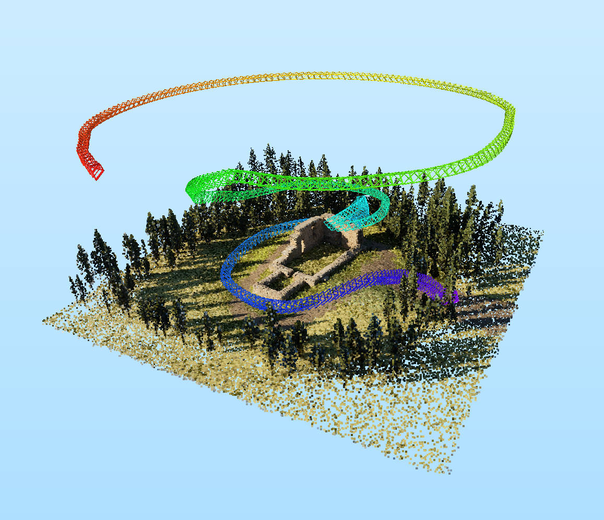
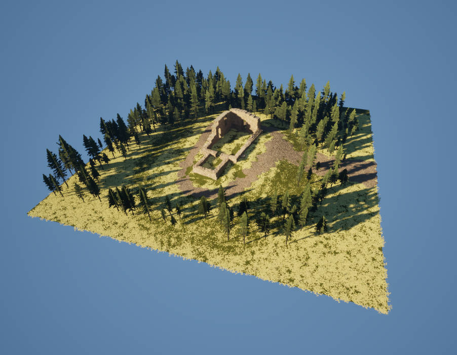

<h1 align="center">LongRecon Benchmark: A Large-Scale Benchmark for Continuous Long-Sequence 3D Reconstruction</h1>

<h4 align="center"><a href="https://huggingface.co/datasets/DengKaiCQ/LongRecon" target="_blank">Huggingface (Uploading)</a></h4>

A large-scale benchmark for continuous, long-sequence 3D reconstruction. Each sequence uses Unreal Engine to render synchronized RGB and depth along a camera trajectory, with ground-truth camera intrinsics and poses.

## 1. Benchmark specifications

| Property | Value |
| --- | --- |
| RGB and depth resolution | 720p (1280 × 720 pixels) |
| Frame rate | 30 FPS |
| Typical sequence duration | 17–32 minutes |
| Average camera path length | 8.119 km |

The benchmark targets the time duration of a single-battery flight for a compact DJI drone.

## 2. Getting the data

### Download from the command line

Install the Hugging Face CLI. The dataset is public and supports anonymous downloads. [Hugging Face CLI](https://huggingface.co/docs/huggingface_hub/en/guides/cli)

```bash
python -m pip install -U huggingface_hub
```

**Download the full dataset** into `./LongRecon`.

```bash
hf download DengKaiCQ/LongRecon --repo-type dataset --local-dir ./LongRecon
```

**If you'd like download only RGB and camera poses**. Below selects the files under each sequence's `image_jpg/` directory and its `pose.zip`.

```bash
hf download DengKaiCQ/LongRecon --repo-type dataset --include "*/image_jpg/*" --include "*/pose.zip" --local-dir ./LongRecon-RGB-Pose
```

You can also manually download individual archives from the [sequence browser](https://huggingface.co/datasets/DengKaiCQ/LongRecon/tree/main/LongRecon-Benchmark).

### Download via HF-Mirror from mainland China

If transfers from Hugging Face are slow, set the mirror endpoint in your terminal and run either download command above in the same terminal.

```bash
export HF_ENDPOINT=https://hf-mirror.com
export HF_HUB_DISABLE_IMPLICIT_TOKEN=1
```

### Extract the archives

Use the parallel extractor to unpack RGB or depth archives quickly. It processes up to **8 ZIP shards in parallel** by default and displays progress, speed, and an ETA. 

Set `ZIP_DIR` at the top of the script to the sequence's `image_jpg/` or `depth_exr/` directory containing the ZIP files. Run the command below from the repository root.

```bash
python -u utils/extract_image_or_depth_zips.py
```

The script writes the extracted files into a sibling directory alongside the input folder.

Extract `pose.zip` at the sequence root to create `pose/`. For point cloud fusion, set `RGB_DIR` and `DEPTH_DIR` in `utils/fuse_pcd.py` to the respective `_unzipped` directories.

## 3. Data layout
Each sequence is distributed as ZIP archives together with preview videos and PLY visualizations.

```text
LongRecon-Benchmark/
└── <Sequence Name>/
    ├── depth_exr/
    │   ├── depth_exr_0001.zip
    │   └── ...
    ├── image_jpg/
    │   ├── image_jpg_0001.zip
    │   └── ...
    ├── pose.zip
    ├── image_video.mp4
    ├── depth_video.mp4
    ├── camera_viz_5_steps.ply
    ├── global_pcd_4000x_downsampled.ply
    └── length.txt
```

Extract the depth and RGB archives into `depth_exr/` and `image_jpg/`, respectively. Extract `pose.zip` into the sequence directory to create `pose/`.

```text
<Sequence Name>/
├── image_jpg_unzipped/
│   └── image_000000.jpeg, ...
├── depth_exr_unzipped/
│   └── depth_000000.exr, ...
└── pose/
    ├── K/
    │   └── 000000.txt, ...
    ├── T_wc/
    │   └── 000000.txt, ...
    └── T_cw/
        └── 000000.txt, ...
```

Sequences can also include `image_video.mp4` and `depth_video.mp4` for previewing the trajectory, `camera_viz_5_steps.ply` for viewing camera poses, `global_pcd_4000x_downsampled.ply` for viewing the scene, and `length.txt` for the total camera path length.

## 4. Coordinate conventions

Each frame provides a 3×3 intrinsics matrix `K` and two 4×4 homogeneous pose matrices. For homogeneous column vectors, the transforms are defined as follows.

- **Camera pose** follows OpenCV conventions. `+X` points right, `+Y` points down, and `+Z` points forward along the optical axis, in meters.

 - **The EXR depth** used for fusion is camera-space `Z` depth. Multiply the stored depth values by `200` to obtain meters (`depth_meter = depth * 200`).

## 5. Python Tools Installation

Run the commands below from the repository root.

```bash
conda create -n longrecon python=3.11 -y
conda activate longrecon
python -m pip install -r requirements.txt
```

## 6. Python Tools Usage

### Inspect an EXR depth map

Pass the path to an extracted EXR to print the selected depth channel, image dimensions, and raw sample statistics.

```bash
python utils/readexr.py "path/to/sequence/depth_exr/depth_000000.exr"
```

### Fuse RGB-D frames into a point cloud

Set `DATA_DIR` in [utils/fuse_pcd.py](utils/fuse_pcd.py) to the extracted sequence directory and run the command below.

```bash
python -u utils/fuse_pcd.py
```

The script uses frame IDs shared by RGB, EXR, `K`, and `T_wc`. By default it uses `FRAME_STEP = 5` frames and samples `SAMPLE_RATIO = 0.00125` of the valid pixels per selected frame, producing `global_pcd_4000x_downsampled.ply` in the sequence directory. Set `STORAGE_MODE = "disk"` to write and merge temporary PLY chunks for sequences that need more memory than is available.

For a dense preview of the first few matching frames, set `FRAME_STEP = 1`, `SAMPLE_RATIO = 1.0`, and a small `MAX_FRAMES`. To fuse specific frame IDs with [utils/fuse_selected_frames.py](utils/fuse_selected_frames.py), set `FRAME_IDS` and adapt its directory and filename templates to the extracted layout.

### Export camera frustums and path length

Set `DATA_DIR` in [utils/export_camera_frustums.py](utils/export_camera_frustums.py) to the extracted sequence directory. On case-sensitive file systems, set `POSE_DIR = DATA_DIR / "pose"` to match the archive.

```bash
python utils/export_camera_frustums.py
```

The script exports colored wireframe frustums to `camera_viz_5_steps.ply` by default. Set `is_glb = True` to also export GLB. The `length.txt` file records the total path length in meters using all `T_wc` poses, even when the visualization uses a frame step.

### Evaluate a camera trajectory

The [VGGT-Long trajectory evaluation script](eval/ate_single_vggt_long.py) takes estimated and ground-truth trajectories in KITTI format and reports ATE and RPE. Set `pose_est_path` and `pose_gt_path` in the script before running it. Evaluation also requires `evo==1.14.0`, `scipy`, and `matplotlib`.

## 7. Example scenario

`LongRecon-Example/Seq-00-Example/` contains **1,763 frames** at 30 FPS (about **58 seconds**) along a **396.101 m** camera path. Extract the archives using the same layout as the benchmark sequences. [Example on Hugging Face](https://huggingface.co/datasets/DengKaiCQ/LongRecon/tree/main/LongRecon-Example-Ruins)


You can open the PLY point cloud and camera frustums in [MeshLab](https://www.meshlab.net/).

<div align="center">

</div>

And the actual rendered example scene would be like

<div align="center">

</div>

## Terms of use

The code in this repository is available under the [BSD 3-Clause License](LICENSE). By downloading LongRecon Benchmark, you agree to use it solely for non-commercial purposes, such as research and benchmark evaluation. Use of the dataset, in whole or in part, to train, pre-train, or fine-tune a deep learning model is prohibited. [Dataset terms on Hugging Face](https://huggingface.co/datasets/DengKaiCQ/LongRecon#terms-of-use)

## Citation

If you use this repository in your academic project, please cite our work below:

```
Oops, working on it :)
```
